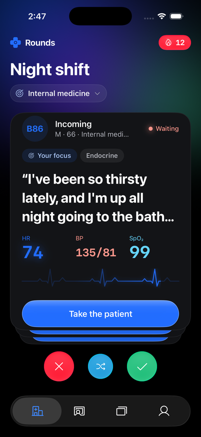
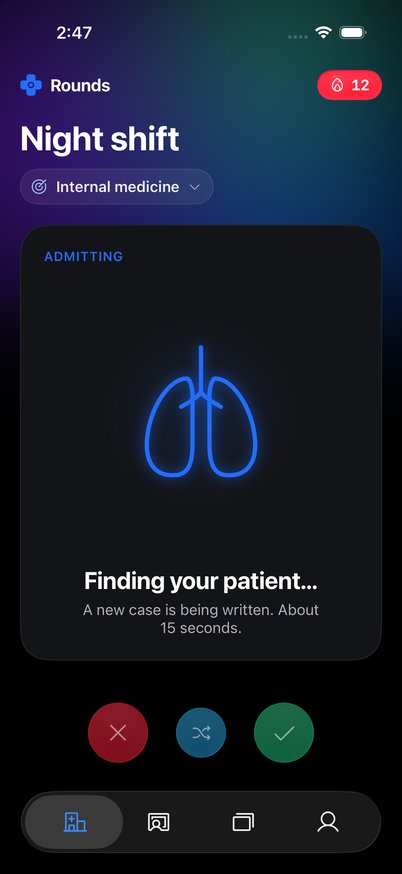
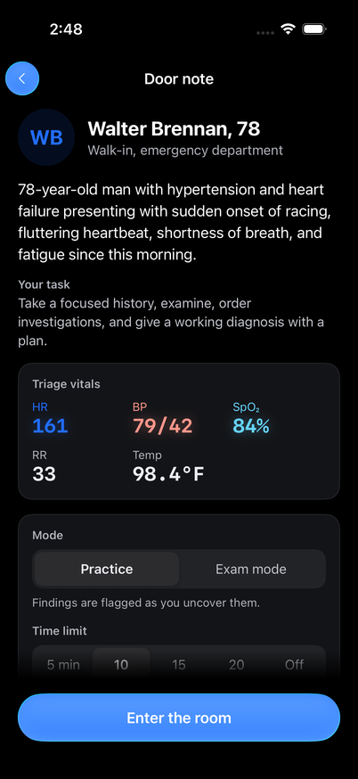
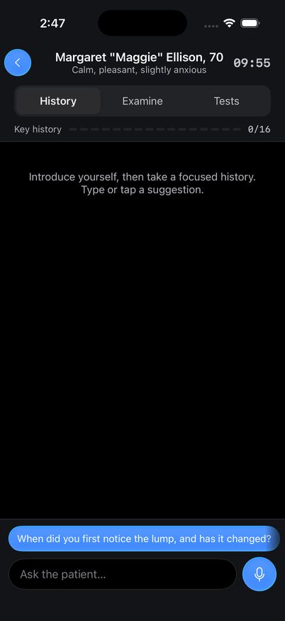
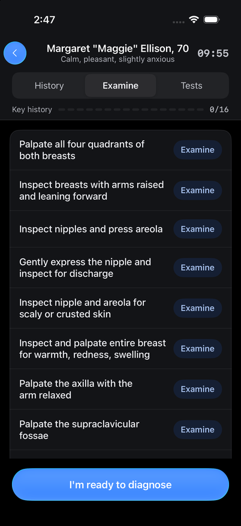
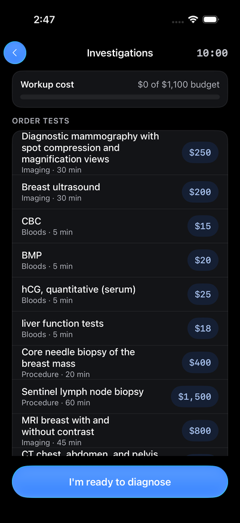
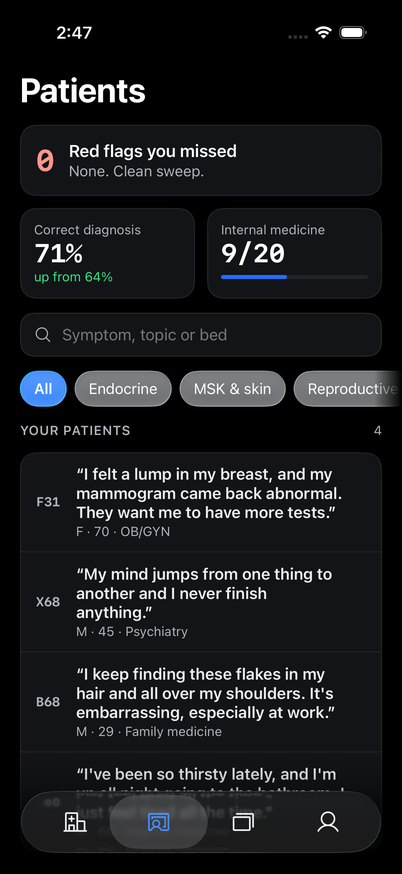

# Rounds

A clinical-reasoning trainer for US medical students. Take a fictional patient's history, examine them, order tests, commit to a diagnosis and get graded feedback. Every patient is written fresh by an AI model from a validated condition profile, so no two cases are the same. For education and practice only: fictional patients, not medical advice.

<p>




</p>
<p>



</p>

## How it works

1. **Knowledge base.** Public-domain medical sources (MedlinePlus, MeSH, ICD-10-CM, PubMed citations, openFDA drug labels, CDC pages) are pulled through their official APIs into `knowledge-base/`.
2. **Condition profiles.** An LLM turns each condition into a structured profile: presentation, exam findings, lab patterns by severity, workup, differential, rubric. Every profile is checked against a schema and rule checks before use, and awaits clinician review.
3. **A new patient.** When a student admits a patient, code plans the case from a profile (severity, age, findings, and lab values from a consistency engine), and the model writes the person around that plan.
4. **The encounter.** The patient model answers in character, seeing only the facts it may reveal, never the diagnosis. Exam findings and results stay on the server until the student asks for them.
5. **Grading.** The server scores history, exam, must-not-miss screening, tests and the diagnosis, then writes the debrief.

## Repository

| Folder | What it is |
| --- | --- |
| `Rounds - IOS/` | SwiftUI iOS app (iOS 17+). XcodeGen: run `xcodegen generate`, then open `Rounds.xcodeproj`. |
| `supabase/` | Postgres schema and row-level security (`migrations/`), seed data, and edge functions: `generate-case` writes a patient, `case-session` runs and grades the encounter. |
| `knowledge-base/` | Sources, lab reference ranges, the profile schema (`schema/`) and generated profiles (`profiles/`). See its README for licenses. |
| `tools/kb-import/` | Scripts that download the public-domain sources. |
| `tools/kb-generate/` | The profile generator (triage, staged generation, validation, auto-repair) and its prompts. |

## Run it locally

Needs Docker (OrbStack works), the Supabase CLI, Xcode, and an API key for the model.

1. **Model key.** Copy `tools/kb-generate/.env.example` to `.env` and set `DEEPSEEK_API_KEY` (or switch `LLM_PROVIDER` to `anthropic` or `openai`). Put the same lines in `supabase/functions/.env`. Both files are git-ignored.
2. **Backend.**
   ```bash
   supabase start                 # local Postgres, auth and API on port 55321
   supabase db reset              # schema, seed and the generated profiles
   supabase functions serve --env-file supabase/functions/.env
   ```
3. **App.** Copy `Rounds - IOS/Config/Secrets.example.xcconfig` to `Secrets.xcconfig` and point it at your Mac, for example `http:/$()/YOUR-MAC.local:55321` with the local publishable key from `supabase status`. Use the Mac's `.local` name, not `127.0.0.1`, so a physical iPhone on the same Wi-Fi can reach it.
4. **Run.** Open the project in Xcode, run, and tap **Admit a new patient**. The app signs in anonymously for now.

### Generating more profiles

```bash
cd tools/kb-generate
python3 generate.py triage              # which conditions make good cases
python3 generate.py profile --top 20    # full profiles for the most common ones
python3 load_profiles.py --apply        # load passing profiles into the local database
```

## Safety and data

- **Answers stay server-side.** Profiles, patient scripts, results and rubrics live in the `private` schema, which the app can't read. Only edge functions use them, with the service role.
- **Keys stay out of the app.** The model key is used only by the edge functions and the offline generator.
- **No real patients.** Every patient is fictional, and the app never asks for real patient data.
- **Not yet clinician-reviewed.** Generated profiles and the hand-written lab reference ranges are teaching material, marked `review: pending`.

## Status

- **Working:** live case generation, the AI patient, exam, tests and grading.
- **Sample data for now:** profile stats, streaks and flashcards.
- **Not yet built:** real accounts. Sign-in is anonymous.
- **Waiting on access:** SNOMED CT (UMLS license) and NCI PDQ (content-partner agreement).
