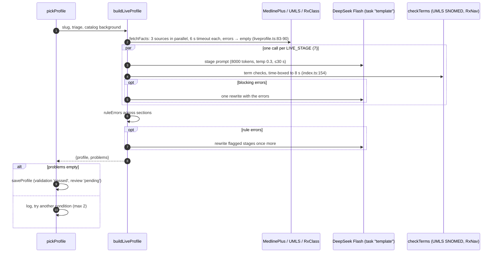

# Case generation: current state

How Rounds makes a new fictional patient on demand, as the code stands on branch `more-conditions` (2026-10-19). Three views: runtime, deployment, integration boundaries. Facts marked *measured 2026-10-19* come from production logs and timing runs this session; everything else is read from code (file:line). Inferences are labelled.

**Scope:** `generate-case` (inline write, ready-case claim, write-ahead), live profile build, and the parts of `case-session` and `prepare-profile` that read or write what generation produces.

---

## 1. Runtime view

### Summary

One edge function, `generate-case`, does everything in the request: it verifies the caller, then either claims a case that was written earlier (`private.ready_cases`) or writes one inline, inserts it, replies with the bed code, and starts writing the *next* case with `EdgeRuntime.waitUntil`. Code fixes the medicine (plan, skeleton, name); the LLM only voices it, and a second model audits the wording. Background write-ahead is only a head start: no student ever waits on it (`index.ts:94-97`).

### Major runtime elements

| Element | Where | Job |
|---|---|---|
| `AppState.admit` / `prepareAhead` | `Model/AppState.swift:197`, `:235` | Start a case (Patients deck); ask for write-ahead once per focus (Home `.task`, `HomeView.swift:71`) |
| `LiveCaseService.admit` / `prepare` | `Services/Cases/LiveCaseService.swift:61`, `:68` | `POST generate-case {focus, polling}` / `{focus, prepare:true}` |
| request handler | `generate-case/index.ts:77-103` | auth, claim-or-write, insert, queue next |
| `claimReady` | `index.ts:180-185` | `DELETE … RETURNING` the one ready row; discard if older than 3 days (`READY_FOR`, `:75`) |
| `writeNow` | `index.ts:211-223` | inline write under a 120 s budget (`GENERATION_BUDGET_MS`, `:49`) |
| `pickProfile` | `index.ts:124-164` | one random condition in focus, avoiding the last 15 (`:106`); prefers a stored profile when `waiting`; else `buildLiveProfile`; 2 tries (`LIVE_TRIES`, `:109`) |
| `buildLiveProfile` | `_shared/liveprofile.ts:266-308` | NLM facts → parallel template calls → per-section checks/rewrites → cross-section rule rewrite |
| `composeCase` | `index.ts:288-342` | `planCase` (`casegen.ts:156`) → background record (`:426`) → `buildSkeleton` (`skeleton.ts:252`) → `patientName` (`names.ts:33`) → writer ×2 → leak fix → fact audit → template fallback |
| `insertCase` | `index.ts:511-534` | `public.cases` + `private.case_content` in one transaction, bed-code retry on 23505 |
| `queueGeneration` → `startGeneration` → `writeAhead` → `finishGeneration` | `index.ts:254`, `:191`, `:226`, `:265` | background job slot per (user, focus) in `private.case_generation_jobs`; result into `ready_cases` |
| `completeJSON` | `_shared/llm.ts:104-141` | budget check → provider call → usage row → JSON parse |

### Flow A: inline generation (no ready case)

```mermaid
sequenceDiagram
  autonumber
  participant App as iOS AppState.admit
  participant GC as generate-case (edge)
  participant Auth as Supabase Auth
  participant DB as Postgres (pooler, 1 conn)
  participant NLM as NLM APIs
  participant DS as DeepSeek Flash
  participant OA as OpenAI GPT-6 Luna
  App->>GC: POST {focus, polling:false} + JWT
  GC->>Auth: GET /auth/v1/user (http.ts:39)
  GC->>DB: DELETE ready_cases RETURNING (none)
  GC->>DB: last 15 condition slugs; pick 1 condition (+stored profile?)
  alt stored profile (~0.1 s)
    DB-->>GC: profile jsonb
  else live profile (~10-15 s, Flow D)
    GC->>NLM: MedlinePlus + UMLS + RxClass
    GC->>DS: 7 template calls in parallel
    GC->>DB: INSERT condition_profiles review='pending' ON CONFLICT DO NOTHING
  end
  GC->>DB: patient_backgrounds by sex/age
  Note over GC: planCase, buildSkeleton, patientName (pure code)
  GC->>DS: CASE_VOICE writer (~7-9 s), max 2 tries
  opt diagnosis leaked
    GC->>DS: CASE_FIXER (field-level, 2-3 s)
  end
  GC->>OA: FACT_AUDITOR (~2-4 s)
  opt "invented" flags
    GC->>NLM: UMLS concept lookups (confirmWithUmls)
    GC->>DS: FACT_FIXER
  end
  GC->>DB: tx INSERT public.cases + private.case_content
  GC-->>App: 200 {case_id, model}
  GC--)GC: waitUntil(queueGeneration) (Flow C)
  App->>DB: loadCase(bed) via PostgREST/RLS
```

Every `completeJSON` also does a `takeBudget` read and a `recordUsage` write on the same DB connection (`llm.ts:111`, `:136`).

*Measured 2026-10-19:* inline total ~10–12 s with a stored profile, ~20–25 s with a live one. Writer ~7–9 s, audit ~2–4 s.

### Flow B: ready-case claim

`claimReady` deletes and returns the row atomically (`index.ts:181-183`), so two taps can never both get it. A fresh row is inserted under a new bed code and the request returns in well under a second; `queueGeneration` then refills the slot. A stale row (>3 days) is deleted and the request falls through to Flow A.

### Flow C: write-ahead (after every start, and `prepare:true` from Home)

```mermaid
sequenceDiagram
  autonumber
  participant Home as HomeView .task(id: focus)
  participant GC as generate-case (same worker, after response)
  participant DB as Postgres
  Home->>GC: POST {focus, prepare:true} (one per topic, max 4)
  GC-->>Home: 202 {status:"preparing"}
  GC--)DB: tx: INSERT jobs ON CONFLICT DO NOTHING; SELECT … FOR UPDATE
  alt running and started < 3 min ago
    Note over GC: return "pending", do nothing
  else queued / failed / stale
    GC->>DB: UPDATE status='running', started_at=clock_timestamp() RETURNING started_at::text (token)
    GC->>DB: ready_cases row exists? then finish with no rows
    Note over GC: pickProfile(waiting = prepare) → composeCase (Flow A steps, 120 s budget)
    GC->>DB: tx: job row with started_at::text = token? INSERT ready_cases ON CONFLICT DO NOTHING; DELETE job
  end
```

- `prepare:true` sets `waiting=true` (`index.ts:86`), so Home head starts prefer stored profiles; the post-start refill uses `waiting=false` (`:101`) and picks from the whole catalog, which is how live profiles get built and saved.
- The token is compared as text (`:271`); passing it back as a timestamptz lost microseconds and discarded **every** background case until it was fixed today (*measured 2026-10-19*).
- *Measured 2026-10-19:* stored-path background jobs finish in ~0.3 s after the response. **Live-path background jobs never finish in production**: jobs stay `running`. Cause unproven. Supporting evidence: `prepare-profile` logs show the worker "dropped about 75 s in" when a stage did all its work in one call (`prepare-profile/index.ts:44-46`). Inference: the worker is being reclaimed after the response, before a 20–25 s live build plus compose completes, or the CPU limit trips during parallel JSON/validation work.
- A job stuck `running` blocks new write-ahead for that (user, focus) for 3 minutes (`:196`, `:201`), then is retaken.

### Flow D: live profile build



*Measured 2026-10-19:* facts ~1 s, template calls ~7–10 s, cost ~$0.02–0.03 per live profile.

### Failure paths and recovery

| Failure | Where | What happens |
|---|---|---|
| Bad/missing JWT | `http.ts:37-40` | 401 before any work |
| No condition in focus, or 2 live profiles fail checks | `index.ts:143`, `:215` | 503 "Couldn't prepare a patient just now" |
| 120 s budget spent | `timeoutFor`, `index.ts:55-58`, `:156` | 504; per-call timeouts: template 30 s, writer 40 s, audit 10 s, fixes 12 s |
| Writer fails twice | `index.ts:327-336` | template voice (`template.ts:103`): plainer but correct; only 502 if that still leaks |
| Fact audit call fails | `index.ts:386-389` | advisory: case ships unaudited |
| UMLS slow during audit | `index.ts:377-382` | race against remaining budget; unconfirmed flags kept |
| Background record lookup fails | `index.ts:433-436` | case written without one |
| Daily LLM budget reached | `usage.ts:44-47` | 503 on next model call; budget lookup failure lets calls through |
| `saveProfile` fails | `index.ts:176` | error swallowed, **but** `case_content.condition_slug` still references `condition_profiles(slug)` (`20261005000000_live_cases.sql:47`), so the case insert then fails with an FK error → 500. Inference from schema; not observed. |
| Bed-code collision | `index.ts:530` | up to 5 retries |
| Background job dies | — | job stays `running`; retaken after 3 min; student unaffected (falls back to Flow A) |
| Quota | `index.ts:36-37`, `:93` | **disabled** today (user request); no per-student cap on case starts, only the project-wide $25/day cap (`usage.ts:21`) |

### Evidence vs assumptions

- Evidence: code paths above; timings, costs and the stuck live jobs (*measured 2026-10-19*).
- Assumption: why live background jobs die (worker reclaim vs CPU vs wall clock). Not proven.
- Assumption: the iOS functions client uses the default URLSession timeout (60 s idle); a live inline build plus retries can approach it. Not measured.

---

## 2. Deployment view

```mermaid
flowchart LR
  subgraph Device["iPhone (iOS 17+)"]
    A[Rounds app\nAppState / LiveCaseService]
  end
  subgraph Supa["Supabase project mpyxaefnytviwnjuqtbu"]
    GoTrue[Auth]
    subgraph Edge["Edge Runtime (Deno isolates)"]
      GC[generate-case]
      CS[case-session]
      PP[prepare-profile]
      VS[voice-sweep]
    end
    Pool[Supavisor pooler\ntransaction mode]
    subgraph PG["Postgres"]
      Priv[(private.*: conditions,\ncondition_profiles, ready_cases,\ncase_generation_jobs, case_content,\nllm_usage, patient_backgrounds)]
      Pub[(public.cases, attempts)]
      Cron[pg_cron + pg_net]
      Vault[Vault: project_url,\nservice_role_key MISSING]
    end
  end
  DS[DeepSeek API]
  OA[OpenAI API]
  NLM[NLM: MedlinePlus, UMLS UTS, RxNav]
  A -- HTTPS + JWT --> GC
  A -- PostgREST + RLS --> Pub
  GC --> GoTrue
  GC -- postgres.js max 1 --> Pool --> PG
  GC --> DS & OA & NLM
  Cron -. net.http_post (inert) .-> PP & VS
```

| Element | Runs where | Scale unit | Statefulness | Security notes | Observability |
|---|---|---|---|---|---|
| Rounds iOS app | Student's iPhone | per device | session in keychain; `preparedFocus` in memory | ships URL + anon key only | none server-side beyond function logs |
| `generate-case` | Supabase Edge (Deno isolate) | isolate per load; platform-scaled | stateless; one postgres.js connection per isolate (`db.ts:14`) | verifies JWT via `/auth/v1/user`; uses DB as `postgres` role, bypasses RLS, so every query filters by caller | `console.log` JSON `case_generated` lines (`index.ts:218`, `:242`) |
| Background write-ahead | Same isolate, `EdgeRuntime.waitUntil` | rides the request's isolate | job row in `case_generation_jobs` | same as above | `case_generated` with `waiting`; failures only as `console.error` |
| `prepare-profile` | Supabase Edge | self-chaining calls | `private.profile_jobs` draft per stage | service-role bearer only (`prepare-profile/index.ts:49-51`) | logs |
| `case-session` | Supabase Edge | per request | reads `case_content.profile` (fallback to stored profile, `case-session/index.ts:550-551`) | JWT | logs |
| Postgres + pooler | Supabase managed | 1 primary; pooler 200 clients | source of truth; `private` schema revoked from anon/authenticated | RLS on public tables | `private.llm_usage` per day/task/model |
| pg_cron jobs | Inside Postgres | `core-profile-batch` every 2 min (`core_profile_batch.sql:344`), `voice-call-sweeper` every 1 min (`voice_call_sweeper.sql:51`) | — | read service key from Vault | `raise notice` only |
| DeepSeek / OpenAI / NLM | Third-party SaaS | vendor | stateless to us | keys via `supabase secrets` (`llm.ts:109`, `terms.ts:28`) | usage table (LLM only); NLM uncounted |

### Consequences of where things run

1. **Platform limits shape the design** (Supabase Edge, *measured 2026-10-19*): 2 s CPU per request (I/O excluded), 150 s wall clock on free / 400 s paid, 256 MB. The 120 s generation budget (`index.ts:49`) sits under the free wall clock; `prepare-profile` splits stages across calls for the same reason (`prepare-profile/index.ts:41-46`).
2. **`waitUntil` is not a job queue.** Background work shares the request's isolate and has no retry, no visibility beyond logs, and no guarantee of completion. Short stored-path jobs survive; 20 s+ live-path jobs do not (*measured*). Consequence: the catalog does not fill itself in production the way `index.ts:7-8` describes, except through inline live builds where a student waits.
3. **One DB connection per isolate.** Each LLM call adds two DB round trips (budget read, usage write). Seven parallel template calls, term checks and a concurrent background job in the same isolate all serialize on that connection. Inference: adds latency under load; not measured.
4. **pg_cron is installed but inert.** Vault secrets `project_url` and `service_role_key` are missing (*measured*), so `advance_profile_batch` and `sweep_voice_calls` return early (`core_profile_batch.sql:310-315`, `voice_call_sweeper.sql:33-37`). No profiles are pre-built by schedule; overdue voice calls are only closed by the student's own next voice request.
5. **Catalog coverage drives latency.** 718 case-suitable conditions, ~240 with stored profiles (*measured*). Any focus with no stored profile always pays the live path inline (~20–25 s). ~49 umbrella topics (e.g. `drug-use-and-addiction`) are case-suitable but yield vague cases.
6. **Cost per case** (*measured*): writer ~$0.006, audit ~$0.001, plus ~$0.02–0.03 when a live profile is built. A live build in a doomed background job is paid for and thrown away.

---

## 3. Integration boundaries

| Boundary | Producer | Consumer | Contract | Sync/async | Ownership | Risk |
|---|---|---|---|---|---|---|
| App → `generate-case` | iOS `LiveCaseService.swift:61-70` | `index.ts:77-103` | `POST {focus, polling?, prepare?}` → `200 {case_id, model}` or `202 {status:"preparing"}`; errors `{error}` with 401/502/503/504 | sync HTTP | us (app + function) | `polling` is ignored (`:79`); app still loops on `.preparing` for up to 8 min (`AppState.swift:192-224`) that the server no longer sends for a start; comment "Generation takes 2–4 minutes" is stale. Low risk, dead path. |
| App → `case-session` / PostgREST | iOS | case-session, `public.cases` RLS | bed code from generate-case; case rows read under RLS | sync | us | none new |
| `generate-case` → Supabase Auth | function | GoTrue `/auth/v1/user` (`http.ts:39`) | bearer JWT → user id | sync | Supabase | extra network hop per request |
| `generate-case` → Postgres | function | `private.*`, `public.cases` | SQL via pooler, `postgres` role, no RLS (`db.ts:1-14`) | sync | us | authorization lives in each query's `where user_id = …`; one connection per isolate |
| Generation → `private.condition_profiles` | `saveProfile` (`index.ts:169-177`), `prepare-profile`, `seed_conditions.sql` / loaders | `pickProfile` (`:138`), `case-session` (`:550`) | profile jsonb schema 0.2; usable when `validation='passed' and review<>'rejected'` | sync write, later read | shared: generator, batch writer, human reviewers | **Three writers, one table.** Live saves land as `passed`/`pending` and are immediately served to other students before clinician review. FK from `case_content.condition_slug` makes a failed save fail the case. |
| Generation → `private.ready_cases` | `finishGeneration` (`:275`) | `claimReady` (`:180`) | `CaseRows` jsonb (`:69`): exact column set of `cases` + `case_content` minus id/owner | async (stored now, consumed later) | us | **Schema drift:** a row written before a column/rubric change is inserted verbatim up to 3 days later. Also holds the answer key: must stay service-role only (it is, `ready_cases.sql:18`). |
| Request ↔ background job | `queueGeneration` | `case_generation_jobs` | one row per (user, focus); status queued/running/failed; token = `started_at::text` | async, in-isolate | us | Lost workers leave `running` rows; 3-min stale takeover is the only recovery. Token bug fixed today shows how fragile the handshake is. |
| → DeepSeek (`template`, `case`, fixes, `cards`) | `completeJSON` (`llm.ts:43-59`) | api.deepseek.com | OpenAI-style chat, `response_format: json_object`, thinking disabled | sync, timeout per call | vendor | Model returns trailing text (handled by `firstObject`, `llm.ts:185`); peak/off-peak pricing; single provider for all generation content with no fallback provider configured. |
| → OpenAI (`check` = fact audit; patient, grade) | `completeJSON` | api.openai.com | same JSON contract, `reasoning_effort` | sync | vendor | Audit is advisory: an OpenAI outage silently ships unaudited cases (`index.ts:386-389`). |
| → NLM MedlinePlus / UMLS UTS / RxNav | `liveprofile.ts:23-90`, `terms.ts:9-10`, `factaudit.ts:56` | NLM | REST, UMLS API key; 6 s timeouts; failures → empty facts | sync | NLM (licensed: UMLS Affiliate License) | Silent degradation: a profile can be built with no grounding facts; term checks time-box and leave terms unverified (`index.ts:153-154`). SNOMED wording from `patient_backgrounds` reaches the writer only (`background.ts:1-4`). |
| LLM spend cap | every `completeJSON` | `private.llm_usage` via `llm_spend_today()` / `record_llm_usage` | $25/day default, `LLM_DAILY_BUDGET_USD` | sync DB read + write per call | us | Fails open on lookup error (`usage.ts:38-43`); with per-student quota disabled, it is the only cost brake. |
| pg_cron → edge functions | `advance_profile_batch`, `sweep_voice_calls` | `prepare-profile`, `voice-sweep` | `net.http_post` with service key from Vault | async, scheduled | us | **Inert** until Vault secrets are added; nothing alerts on this. |
| `generate-case` → `prepare-profile` | — | — | historically via `_shared/prefetch.ts` `prepareNext/kick` | — | us | No longer wired: only `prepare-profile` imports `kick`; `prepareNext` is unused, and the headers of `prepare-profile/index.ts:3` and `case-session/index.ts:29` still describe the old flow. |
| Generated case → grading | `buildRows` (`index.ts:473-508`) | `case-session` grade, insights, mistake cards | `case_content.profile`, `rubric`, `answer_key`, `facts` | async (later session) | us | Grading reads the case's own profile first, so later profile edits don't change past grades (good); older cases fall back to the stored profile. |

### Boundary recommendations (for the next step, not done here)

1. Move write-ahead off `waitUntil` for anything that can build a live profile: restrict background jobs to stored profiles, or hand live builds to a real queue (pg_cron + a job table, once Vault is set).
2. Decide who owns `condition_profiles`: separate auto-saved live profiles from reviewed ones (e.g. serve `pending` live profiles only to the student who triggered them, or keep them in `case_content.profile` only), and drop or relax the `condition_slug` FK.
3. Version the `ready_cases.rows` payload (prompt/schema version) and discard mismatches on claim.
4. Add the two Vault secrets (a cloud change: ask first) or remove the cron jobs so their state is honest.
5. Remove the client's `.preparing` polling loop and the unused `prefetch.ts` exports.

## Risks (ranked)

1. **High:** live-path write-ahead never completes, so the "catalog fills itself" design does not happen in the background, and live builds there are paid for and lost.
2. **High:** auto-saved live profiles are served to all students with `review='pending'`, while the stated design is clinician review.
3. **Medium:** inline live builds (~20–25 s) for any focus without stored profiles; ~478 conditions still have none.
4. **Medium:** cron jobs (profile batch, voice sweeper) are silently inert.
5. **Medium:** no per-student case cap while quota is disabled; the project-wide cap fails open.
6. **Low:** ready-case schema drift; FK failure on a lost profile save; stale client polling.

## Recommended next skills

- `availability-strategy-reviewer` for the background-job and cron gaps.
- `architecture-option-generator` / `tradeoff-analysis-writer` for where write-ahead and live profile builds should run.
- `adr-writer` for the `condition_profiles` ownership decision.
