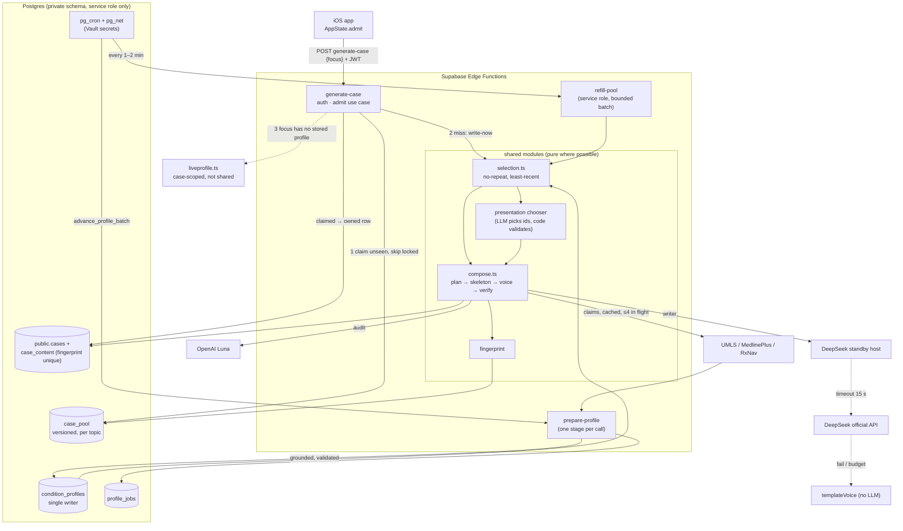

# 04 · Decision: how a "new patient" is produced on demand

Skills applied: architecture-option-generator, tradeoff-analysis-writer, adr-writer. Evidence is
cited as **01** (current state), **02** (quality and risk, scenarios QA-1…QA-9, risks R1…R12) and
**03** (structure, refactor steps 1–8). Tags: **[M]** measured 2026-10-19, **[C]** from code,
**[I]** inference. Read-only review on branch `more-conditions`; nothing here is deployed.

## Summary

- **Chosen: Option D**, a shared, verified **case pool per topic** refilled by a **pg_cron worker**,
  fed by **batch-built stored profiles**, with **AI-chosen presentation from a closed menu** that code
  validates, and a **standby host** for the same DeepSeek model once the owner supplies a key.
- Target: QA-1 p50 ≤ 2 s / p95 ≤ 12 s (today ~10–12 s / ~30–35 s, 02 §Summary), 0 repeats before a
  topic is exhausted (QA-3), 0 unreviewed live profiles served to a second student (QA-4).
- The decision keeps today's strongest asset (pure plan → skeleton → voice → audit modules, 03 §Summary)
  and replaces the weakest (long work on `waitUntil`, 01 Flow C; risks R3, R4, R9).
- Gate for everything that runs on a schedule: **two Vault secrets** (`project_url`,
  `service_role_key`), which only the owner can approve (01 §2 point 4).

## 1. Architecture options

### Context
- **Problem:** tap → unique, medically coherent, human-sounding patient, fast, without trading accuracy.
- **Scope:** `generate-case`, profile building (`liveprofile.ts`, `prepare-profile`), write-ahead,
  selection, audit; `case-session` only as a consumer that must not change (03 §1).
- **Constraints:** Supabase only (edge 150 s wall / 2 s CPU, pg_cron, one DB connection per isolate,
  01 §2); no new dependencies; a faster host needs an owner key; cost ~$0.007 stored / ~$0.03–0.04 live
  per case is accepted; owner chose "stored first, live fallback" and an AI writer over templates.

### Option A · Harden today's inline + per-student write-ahead
- **Shape:** keep `generate-case` as is. Write-ahead always uses stored profiles (`waiting = true`),
  `selection.ts` gives per-focus no-repeat, writer timeout 15 s, 45 s server deadline.
- **Optimizes:** smallest diff; no cron, no Vault dependency.
- **Failure modes:** write-ahead still rides `waitUntil` (02 hotspot 4); only one ready case per
  (student, focus), so the second quick tap waits ~10–12 s; first tap in a topic always inline; topics
  without stored profiles still build live inline (R3); `index.ts` keeps growing (03 finding 1).
- **Best fit when:** Vault secrets cannot be added and launch is days away.

### Option B · Shared ready pool + cron refill + batch-built profiles
- **Shape:** `private.case_pool` per topic, unowned, verified cases; `refill-pool` (pg_cron → pg_net,
  bounded batch, no `waitUntil`) keeps depth N; claim = `delete … for update skip locked … returning`
  excluding the student's seen conditions; `prepare-profile` builds the ~480 missing profiles one stage
  per cron tick (03 §4). Inline write-now only on pool miss, stored profiles only.
- **Optimizes:** p50/p95 (claim ~0.3–1 s [I from 01 Flow B]); work moves off the request; one queue
  instead of one per student; profile batch closes the 240/718 coverage gap (01 §2 point 5).
- **Failure modes:** cron inert without Vault (R9); pool drained by a burst (QA-8) falls back to
  write-now; pool rows can go stale on profile rejection or prompt change (01 §3 schema drift);
  variety limited to code sampling (`planCase` weighted severity and symptom draws, `casegen.ts:156`).
- **Best fit when:** Vault can be set and the catalog must scale beyond per-student head starts.

### Option C · Fully live per case on a faster host
- **Shape:** no pool. Every tap builds or loads a profile and writes the case inline on a faster host
  of the same model (Baseten ~700 vs official ~176 tok/s [M], 02 hotspot 6).
- **Optimizes:** freshness and simplicity of state (no pool, no jobs).
- **Failure modes:** p50 still ~4–6 s stored and ~8–12 s live [I], p95 bound to one vendor's tail;
  live profiles at request time keep R2 (hallucinated profile served) and R5 (UMLS fan-out); cost
  ~$0.03–0.04 per case whenever live; an outage of the single fast host is a full outage of new cases
  unless the official API is kept anyway (R7). Needs an owner key before it works at all.
- **Best fit when:** profiles change daily and pre-generation would be wasted.

### Option D · B + AI-chosen presentation + standby host (hybrid)
- **Shape:** everything in B, plus: (1) a **presentation chooser** step where the LLM picks *which*
  chief complaint, symptoms, exam findings and severity to use **by id from the stored profile's
  menu**; code rejects any id not in the profile, any finding gated above the chosen severity
  (`min_severity`, `casegen.ts:154`) and any plan whose fingerprint already exists; (2) the same
  DeepSeek model on a standby host, used by the inline path first and by refill when the official API
  is throttled; (3) the fallback chain from 02 §4 made explicit with per-step deadlines.
- **Optimizes:** B's latency plus the owner's variety goal without letting the LLM invent medicine
  (the menu is the reviewed profile; code still sets values and the skeleton, 01 §1).
- **Failure modes:** chooser adds one short LLM call per case (~1–2 s, refill path only, so off the
  tap [I]); chooser could bias toward the same few items (mitigated by passing the student-agnostic
  usage counts per item and rejecting repeats via fingerprint); standby host is a second vendor
  contract and key; more moving parts than B for one developer.
- **Best fit when:** speed and variety both matter and a reviewed profile set exists.

## 2. Trade-off matrix

Scores 1 (worst) – 5 (best) against 02's criteria. Latency numbers are [I] unless marked.

| Criterion (source) | A · harden inline | B · pool + cron + batch | C · fully live, fast host | D · B + chooser + standby |
|---|---|---|---|---|
| p50 tap→patient (QA-1) | 3 · ~1 s on hit, 10–12 s miss [M] | 5 · ~0.3–1 s claim | 3 · ~4–6 s | 5 · ~0.3–1 s claim |
| p95 (QA-1, QA-2) | 2 · 12–15 s; live inline topics 30 s+ | 4 · ≤ 12 s; miss = stored write-now | 3 · 10–15 s, vendor tail | 5 · ≤ 10 s; miss uses standby host |
| Uniqueness / no repeat (QA-3) | 3 · per-focus rule, no pool variety | 4 · rule + fingerprint index | 4 · rule + fingerprint | 5 · rule + fingerprint + chosen presentation |
| Accuracy / consistency (QA-4) | 3 · stored profiles, audit fails open | 4 · reviewed profiles, audit counted | 2 · live profiles per case (R2) | 4 · as B; chooser limited to profile ids |
| Cost per started case (QA-5) | 4 · ~$0.007; waste from 4 prepares | 4 · ~$0.007 + pool expiry waste ≤ 20% | 2 · $0.03–0.04 live | 4 · ~$0.008–0.009 (+chooser) |
| Availability (QA-6, QA-7, QA-8) | 2 · every tap needs DeepSeek or template | 4 · pool absorbs outages and bursts | 2 · one vendor on the hot path | 5 · pool + standby + template chain |
| Complexity / ops on Supabase | 5 · nothing new | 3 · new table, cron job, worker, Vault | 4 · new vendor only | 2 · B + chooser + second vendor |
| Migration effort | 5 · days | 3 · 03 steps 1–7 | 4 · config + live hardening | 2 · 03 steps 1–8 + chooser |

**What each gains / loses**
- **A** gains speed of delivery; loses p95 and burst safety, and keeps `waitUntil` as the queue.
- **B** gains latency, burst absorption and one durable queue; loses simplicity and depends on Vault.
- **C** gains freshness; loses accuracy control (profiles unreviewed at serve time) and cost, and still
  needs a fallback host, so it is not actually simpler.
- **D** gains everything B does plus variety and outage tolerance; loses the most simplicity. The extra
  parts are additive and each can be switched off by config, so the loss is bounded.

## 3. ADR-007 · Shared verified case pool with cron refill and chosen presentation

**Status:** proposed (2026-10-19). Owner sign-off needed for Vault secrets and the standby key.

### Context
- Today's tap is p50 ~10–12 s, p95 ~30–35 s (02 §Summary); live write-ahead never completes in
  production [M] (01 Flow C), so the "catalog fills itself" design does not happen (R4).
- Inline live profile builds drive p95 (R3); live profiles are served to every student while
  `review='pending'` (R2, 01 §3).
- One shared $25/day cap covers generation, chat and grading (R1); UMLS fan-out in the audit is
  unbounded (R5); pg_cron jobs are inert without Vault secrets (R9).
- `index.ts` (534 lines) owns nine jobs; the pure modules are sound (03 §1).

### Decision drivers
1. Tap→patient p50 ≤ 2 s, p95 ≤ 12 s (QA-1, QA-2).
2. No repeated condition before topic exhaustion; never an identical patient (QA-3).
3. No unreviewed medicine reaches a second student; audit coverage ≥ 99% (QA-4).
4. Chat and grading never starved by generation spend (QA-7, R1).
5. Survives a DeepSeek outage and a 500-student burst (QA-6, QA-8).
6. Supabase only, no new dependencies, one developer can operate it (03 §3).

### Considered options
A (harden inline), B (pool + cron + batch), C (fully live, faster host), D (B + chooser + standby).
See §1–§2.

### Decision
Adopt **D**, delivered as **B first** and the D additions behind flags:
- **Stored first:** cases are composed from stored profiles built by the cron profile batch
  (`prepare-profile`, one stage per tick; single writer `stores/profiles.ts`, 03 §4).
- **Live fallback, contained:** `liveprofile.ts` runs inline only when the focus has **zero** stored
  profiles; the result is kept in that case's `case_content.profile` only and queued for the batch,
  never served to another student before review. FK `case_content.condition_slug →
  condition_profiles` is relaxed (01 §1 failure table).
- **Pool:** `private.case_pool` (service role only), unowned verified cases per topic, refilled by
  `refill-pool` via pg_cron; claim becomes an owned `public.cases` row in one transaction, so RLS and
  `case-session` are unchanged (03 §2 rules).
- **Selection:** pure `selection.ts` (per-student, per-topic, least-recently-seen); `fingerprint`
  column with a unique index (03 step 4).
- **Variety:** presentation chooser picks ids from the profile; code validates and still sets values.
- **Fallback chain per tap** (02 §4, with deadlines; total server deadline 45 s):
  1. pool claim (unseen condition) → 2. ready case (until retired) → 3. write-now, stored profile,
  writer on standby host 15 s → 4. same on official API 15 s → 5. `templateVoice` (no LLM) →
  6. live profile only if the focus has no stored profile → 7. 503 with retry hint, no quota charged.

### Consequences
**Positive**
- Most taps become a DB claim (~0.3–1 s); the writer and audit run off the tap.
- Burst and outage absorbed by pool depth; spend is shaped by refill, not by tap rate.
- Accuracy control moves to profile review, which is cheaper than auditing every live profile.
- One durable queue replaces per-student `ready_cases` + `case_generation_jobs`.

**Negative**
- New table, cron job, worker and a second vendor: more to monitor for one developer.
- Pool rows go stale when prompts or profiles change; needs versioned rows and purge on rejection.
- A shared pool means two students may get the same condition close together (acceptable, 03 risks).
- Variety depends on the chooser; if it underperforms, fall back to code sampling with no loss of
  correctness.
- Until Vault secrets exist, D degrades to A-with-selection (phases 0–2 still ship value).

### Implementation plan

Each phase is shippable. Exit criteria are read from `case_generated` logs, `private.llm_usage`
and SQL counts over 7 days unless stated.

| Phase | What ships (03 step) | Exit criteria (02 scenario) | Owner must |
|---|---|---|---|
| **0 · Instrument + quick safety** | `ready_hit`, `audited`, `inline_live` fields on `case_generated`; client tap→open timer; per-task budget split (case ≤ 40%, chat+grade reserved) with atomic reserve; UMLS lookups cached and ≤ 4 in flight; app request timeout + server deadline 45 s; restore daily case quota | Metrics visible for every tap; burst replay overshoot ≤ 5% (QA-7); 0 UMLS 429 in a 10-concurrent audit test (R5); 0 cases created after client timeout (R10) | Approve per-task caps and quota numbers; approve `supabase functions deploy generate-case` |
| **1 · Extract modules** (steps 1–3) | `rows.ts`, `compose.ts`, `verify.ts`, `stores/*`; `saveProfile` awaited; `index.ts` ≤ ~100 lines; import-direction test | No behaviour change: p50/p95 within ±10% of phase 0 baseline; Deno tests green | Nothing beyond deploy approval |
| **2 · Selection + fingerprint + stored-only waiting path** (step 4) | `selection.ts`; exposure index; `fingerprint` unique index; write-ahead always `waiting = true`; inline never builds live when a stored profile exists | QA-3: 0 repeats before exhaustion, 0 duplicate fingerprints; QA-2: `source:live, inline:true` = 0 in foci with stored profiles; p95 ≤ 15 s | Approve migration `db push --linked` |
| **3 · Narrow umbrellas** (step 5) | Catalog migration + `tools/kb-generate` re-tag of ~49 umbrella topics | Topic counts reviewed before/after; 0 umbrella slugs case-suitable | Review the umbrella list |
| **4 · Vault + profile batch** (step 6) | `prepare-profile` step-per-request driven by `advance_profile_batch`; ~480 slugs queued; no `kick`/`waitUntil`; refuse to save a profile with empty grounding facts; live profiles case-scoped | ≥ 90% of case-suitable conditions have a `passed` profile; 0 `profile_jobs` stuck > 10 min; batch spend inside its own cap; R2: pending live profiles used by > 1 user = 0 | **Add Vault secrets `project_url`, `service_role_key`**; approve batch daily cap; set up clinician review of `pending` profiles |
| **5 · Pool + refill worker** (step 7) | `private.case_pool` (versioned rows, 3-day expiry, purge on rejection); `refill-pool` on pg_cron every 1–2 min, ≤ 3 concurrent, own USD cap; admit claims pool → else ready case → else write-now | QA-1: p50 ≤ 2 s, p95 ≤ 12 s, pool hit ≥ 80%; QA-9: 0 refill jobs unfinished > 3 min; QA-5: ≤ $0.01 per started case, expired pool rows ≤ 20%; QA-8 burst replay success ≥ 99% | Approve cron migration and refill cap; deploy `refill-pool` |
| **6 · Presentation chooser** (D addition, flag) | Chooser step in refill compose: LLM returns profile item ids + severity; code validates ids, `min_severity`, fingerprint; falls back to `planCase` sampling on any rejection | Chooser rejection rate ≤ 10%; QA-4 clinician sample: 0 wrong diagnosis-defining facts, ≤ 2% unsupported; distinct fingerprints per condition after 20 cases ≥ 15 | Judge variety on 20 sample cases per topic; approve flag on |
| **7 · Standby host** (D addition, flag) | Same DeepSeek model on Baseten/Together as `LLM_MODEL_CASE` standby; writer 15 s timeout then switch | QA-6 fault injection: success ≥ 99%, p95 ≤ 20 s with official API blocked | **Choose host, provide API key** via `supabase secrets set` |
| **8 · Retire write-ahead** (step 8) | Stop `prepare`/`queueGeneration` (202 no-op for old builds); drop `ready_cases`, `case_generation_jobs`; remove iOS `.preparing` loop and `prepareAhead`; delete `prefetch.queueNext/prepareNext` | One app release on pool only with QA-1 still met; 0 calls to removed paths for 14 days | Ship the app release; approve drop migration |

### Follow-up actions
- Record ADR-008 "No unreviewed profile served to a second student" and ADR-009 "Per-task LLM budgets"
  (02 next steps).
- Write the runtime view of the fallback chain with timeouts (02 next steps; `runtime-view-writer`).
- Open questions: pool depth per topic (start at max(3, 0.5 × conditions), tune from hit rate);
  whether the chooser should also run on the write-now path once the standby host makes it ~1 s;
  whether DeepSeek throttles at ~50 concurrent writes (R7 experiment).

## 4. Target architecture

### What changes vs today
- Tap claims a shared, verified pool case instead of a per-student `ready_cases` row (01 Flow B/C).
- Background work runs from pg_cron in its own request, not `EdgeRuntime.waitUntil` (R4, R9).
- Stored profiles come from one builder (`prepare-profile` batch); live profiles are inline only for
  topics with none, and stay with that one case (R2, R3).
- No-repeat is per student **per topic** until exhausted, in a pure `selection.ts`; identical
  patients blocked by a unique fingerprint index (QA-3, R8).
- LLM picks the presentation from the profile's own items; code still fixes the medicine.
- Writer has a 15 s timeout and a standby host of the same model; template voice is the planned last
  step (QA-6, R7).
- Budgets split per task with atomic reserve; UMLS lookups cached and bounded (R1, R5).
- `index.ts` shrinks to an entry point; `ready_cases`, `case_generation_jobs`, the iOS polling loop
  and dead `prefetch` exports are removed (03 steps 1–3, 8).

## Evidence vs assumptions
- **Evidence:** latencies, costs, stuck live jobs, inert cron, catalog sizes [M] (01, 02); module and
  line references [C] (01, 03); `planCase` severity gating `casegen.ts:154-184` [C].
- **Assumptions:** claim latency ~0.3–1 s (from Flow B, not timed under load); standby host speed
  ~700 tok/s carries to our prompts; chooser adds ~1–2 s and improves perceived variety (to be judged
  by the owner in phase 6); pool waste ≤ 20% at the chosen depth.

## Recommended next skill
`runtime-view-writer` for the claim/refill/fallback sequence, then `architecture-risk-assessor` on
phase 5 before the pool migration is written.
